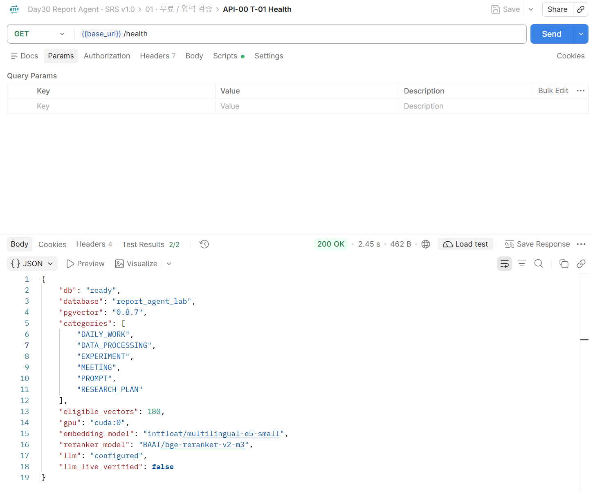
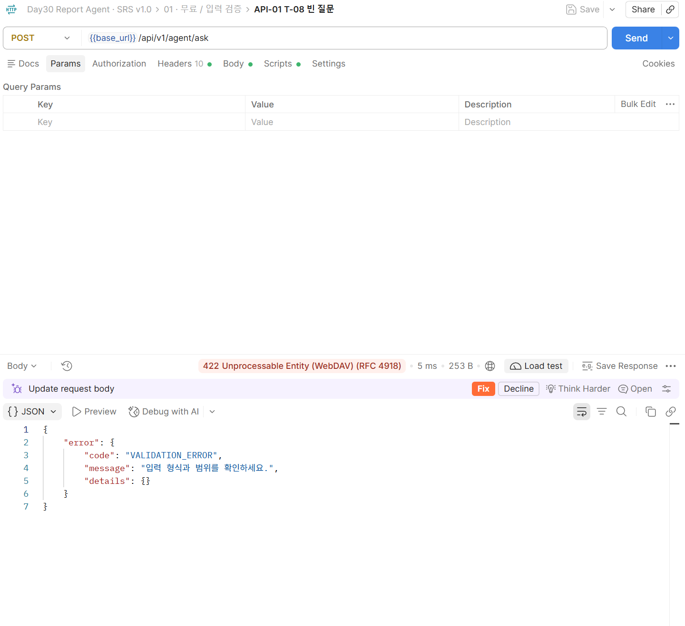
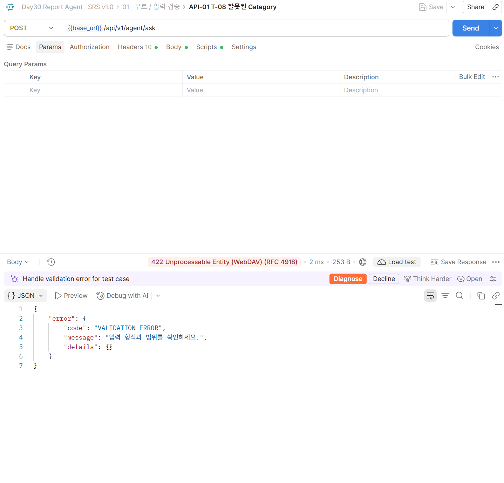
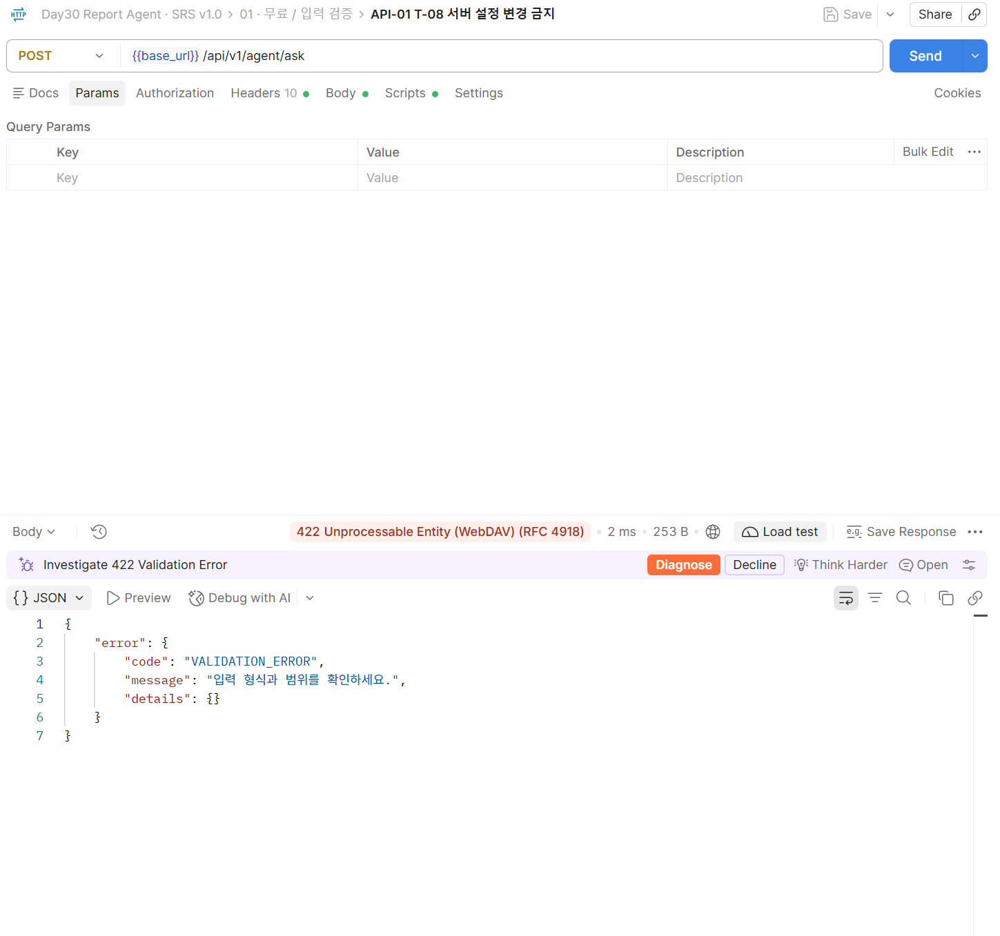
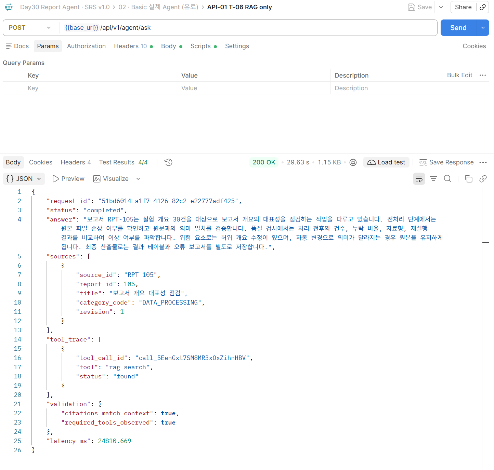
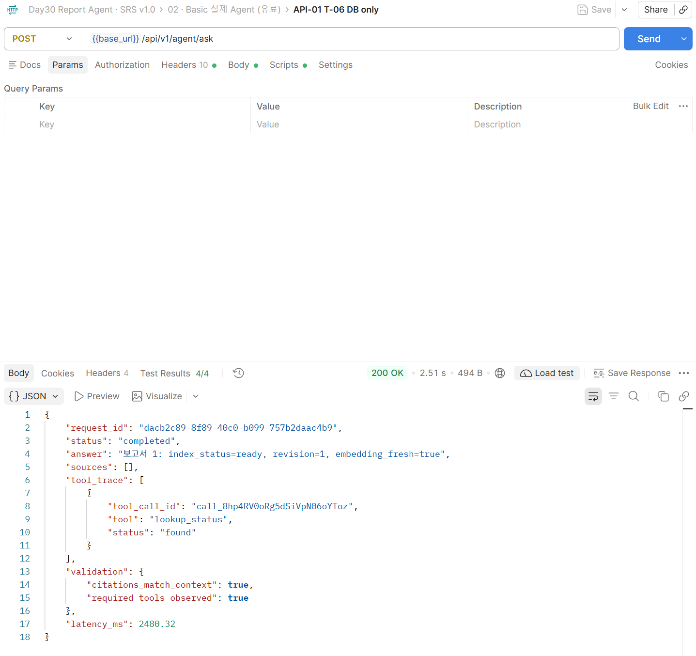
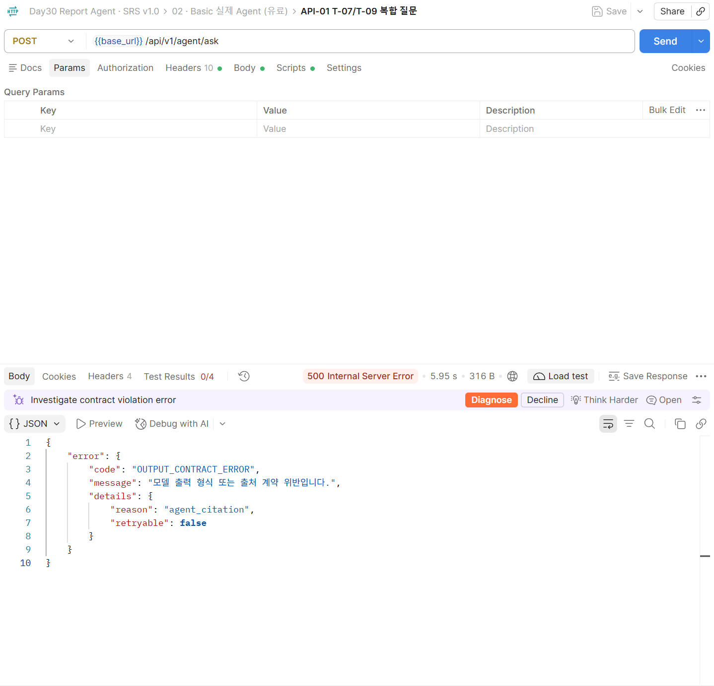
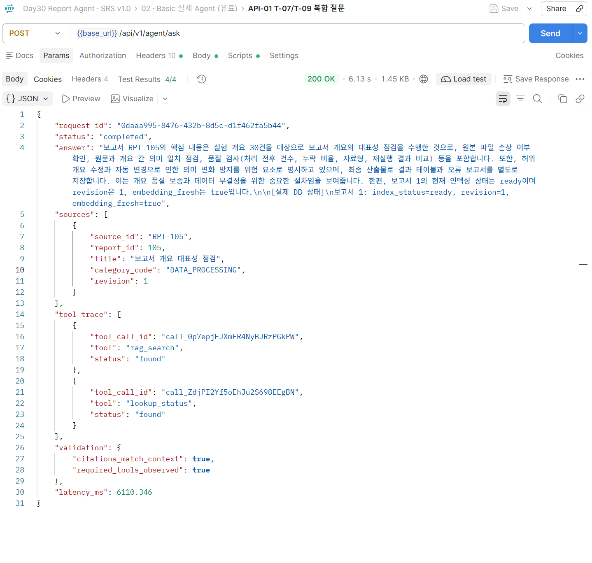
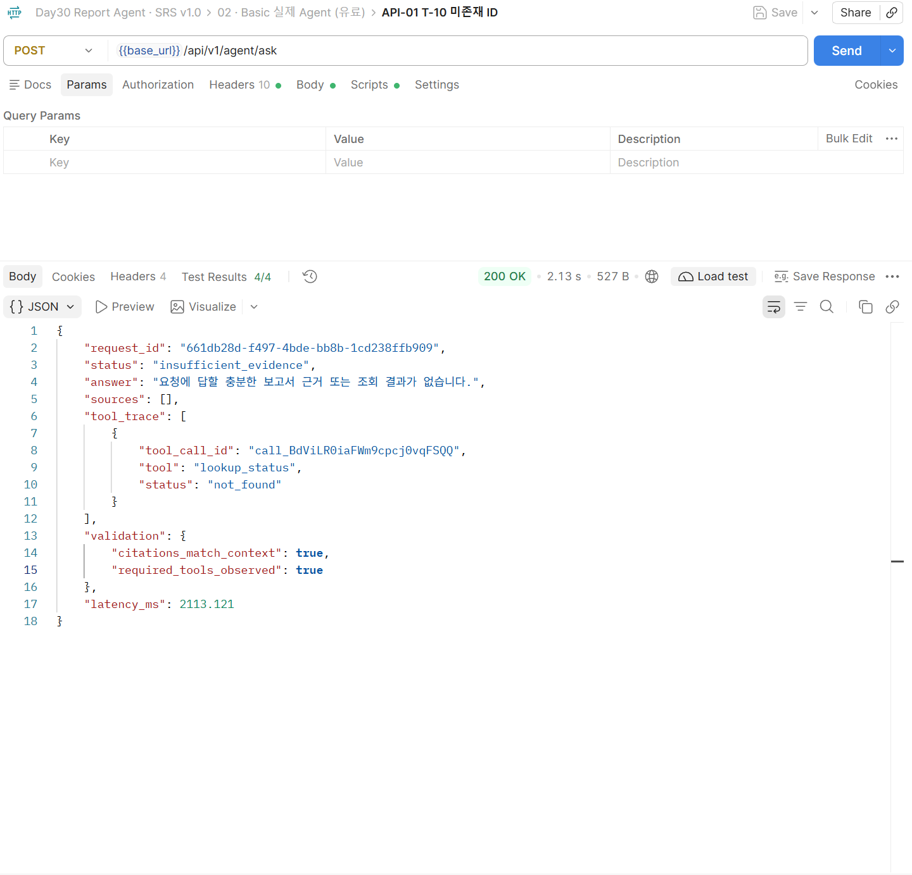
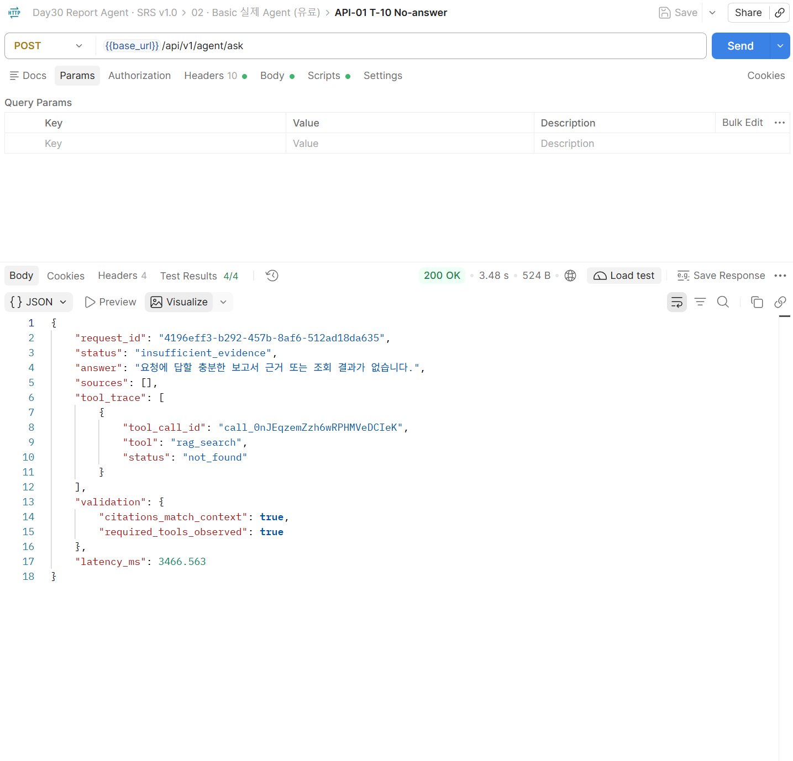

# DAY30 BASIC — LangChain Report Assistant 구현 및 검증 보고서

- **작성일:** 2026-11-27
- **작성자:** Cyberdyne Systems Model 101
- **구현 범위:** DAY30 BASIC (`B-01` ~ `B-15` / `T-01` ~ `T-10`)
- **최종 판정:** **PASS** (단계별 검증, `pytest` 41건, Live 검증, Postman 9건, DB 불변성 검증 전수 통과)

---

## 1. 프로젝트 개요 및 실행 환경

기존 `report_agent_lab` 데이터베이스를 **읽기 전용(`SELECT` Only)**으로 조회하여 기술 보고서의 근거 요약(`rag_search`)과 실시간 인덱싱 상태(`lookup_status`)를 응답하는 FastAPI 기반 LangChain AI Agent 서비스를 구현했습니다.

| 구분 | 구성 요소 및 사양 |
| :--- | :--- |
| **OS / Runtime** | Windows (UCRT64 / Git Bash), Python 3.15.2 |
| **Web Framework** | FastAPI, Uvicorn (`127.0.0.1:8000`) |
| **Database** | PostgreSQL 18 (`report_agent_lab`), `pgvector 0.8.7` (유효 벡터 `180`건, 6종 Category) |
| **GPU / Compute** | NVIDIA GPU (`cuda:0`, PyTorch `cu126`) |
| **Embedding Model** | `intfloat/multilingual-e5-small` (384차원, L2 정규화) |
| **Reranker Model** | `BAAI/bge-reranker-v2-m3` (Cross-Encoder) |
| **Agent / LLM** | LangChain `create_agent` 기반 Tool Loop (`rag_search`, `lookup_status`) |

---

## 2. 단계별 구현 및 검증 결과 (`005` ~ `016`)

### 2.1 단위 및 파이프라인 실측 검증

| 검증 단계 | 검증 대상 및 핵심 내용 | 실행 결과 | 주요 실측 지표 |
| :--- | :--- | :---: | :--- |
| **TEST 005** | 최초 DB Snapshot 저장 (`outputs/db_before.json`) | **PASS** | 10개 테이블 스냅샷 생성 완료 |
| **TEST 006** | HTTP 준비 상태(`/health`) 및 입력 유효성 검증 | **PASS** | `GET /health` 200 OK (`cuda:0`, 벡터 180개), 잘못된 입력 422 반환 |
| **TEST 007** | CUDA 기반 E5 Query Embedding 실측 | **PASS** | `device: cuda:0`, `dim: 384`, `norm_squared: 1.00000005`, `293.89ms` |
| **TEST 008** | `pgvector` 유사도 검색 및 원문 조회 | **PASS** | Top-1 `RPT-63` (`distance=0.0787`), 8개 후보 정렬 확인 |
| **TEST 009** | Cross-Encoder 리랭킹 전후 비교 | **PASS** | `RPT-149` (6위→3위 상승), `RPT-63` (`score=0.9987`), `164.69ms` |
| **TEST 010** | `RagPipeline` 프롬프트 및 출처 메타데이터 조립 | **PASS** | `['system', 'human']` 생성, `context_chars=357`, `RPT-63` 매핑 |
| **TEST 011** | `RagPipeline` 예외 및 경계 조건 검증 | **PASS** | 근거 부족/비정상 입력 분기 정상 동작 |
| **TEST 012** | 최종 Runtime · Agent · RagPipeline 통합 연결 | **PASS** | `compileall` 무오류 및 전체 컴포넌트 정상 바인딩 |
| **TEST 013** | 실제 유료 LLM 기반 단일 RAG Tool 실행 | **PASS** | `RPT-63` 요약 및 `[RPT-63]` 인용, 토큰 사용량 `730 tokens` (`2.51s`) |
| **TEST 014** | 실제 유료 LLM 기반 복합 질문(2-Tool Loop) 실행 | **PASS** | `rag_search` + `lookup_status` 병행 호출, `citations_match_context: true` |
| **TEST 015** | 최종 HTTP 서버 기동 및 OpenAPI 명세 확인 | **PASS** | OpenAPI 경로 `['/api/v1/agent/ask', '/health']` 정상 노출 |
| **TEST 016** | 사전·사후 DB Snapshot 대조 (DB 무결성 검증) | **PASS** | `DB unchanged: True` (행 수 및 데이터 해시 100% 불변) |

### 2.2 자동화 계약 테스트 (`pytest`) 및 Live 스크립트

- **오프라인 계약 테스트 (`python -m pytest tests/ -q -ra`):** 총 **41개 항목 전수 통과** (`41 passed in 0.81s`)
  - `test_contracts.py` (19건), `test_framework.py` (11건), `test_http_contract.py` (9건), `test_sql_contract.py` (2건)
- **Live 통합 시나리오 (`python -m scripts.verify_live --allow-paid-llm`):** `exit=0` **PASS**
  - `rag_only` (`completed`), `db_only` (`completed`), `both` (`completed`), `no_answer` (`insufficient_evidence`), `missing` (`insufficient_evidence`) 5종 시나리오 전수 통과 및 `outputs/live_checks_paid.json` 저장

---

## 3. Postman API-00 / API-01 검증 결과 (Basic 9개 요청)

총 9개 원본 요청(자동 검사 28개 항목)에 대해 개별 실행 및 `pgAdmin` `READ ONLY` SQL 원문 대조를 완료했습니다.

| 번호 | 요청 이름 | 구분 | HTTP | 최종 판정 | 핵심 검증 내용 및 비고 | 검증 스크린샷 |
| :---: | :--- | :---: | :---: | :---: | :--- | :---: |
| **01** | `API-00 T-01 Health` | 무료 | `200` | **PASS** | `db=ready`, `gpu=cuda:0`, `eligible_vectors=180`, `llm=configured` |  |
| **02** | `API-01 T-08 빈 질문` | 무료 | `422` | **PASS** | 공백 질문 입력 시 `VALIDATION_ERROR` 반환 |  |
| **03** | `API-01 T-08 잘못된 Category` | 무료 | `422` | **PASS** | 허용된 6종 Category 외 값 입력 시 `VALIDATION_ERROR` 반환 |  |
| **04** | `API-01 T-08 서버 설정 변경 금지` | 무료 | `422` | **PASS** | API 요청을 통한 실행 상한 변경 시도 차단 (`VALIDATION_ERROR`) |  |
| **05** | `API-01 T-06 RAG only` | 유료 | `200` | **PASS** | `RPT-105`('보고서 개요 대표성 점검') 요약 및 `rag_search` `found` |  |
| **06** | `API-01 T-06 DB only` | 유료 | `200` | **PASS** | `보고서 1: index_status=ready, revision=1, embedding_fresh=true`, `sources=[]` |  |
| **07** | `API-01 T-07/T-09 복합 질문` | 유료 | `200` | **PASS** | 1차 시도 `500 OUTPUT_CONTRACT_ERROR(agent_citation)` 차단 확인 후 2차 재시도 통과 | **[1차 차단]**   **[2차 통과]**  |
| **08** | `API-01 T-10 미존재 ID` | 유료 | `200` | **PASS** | `missing_report_id=999999` 조회 시 `insufficient_evidence`, `not_found`, `sources=[]` |  |
| **09** | `API-01 T-10 No-answer` | 유료 | `200` | **PASS** | 무관 질문 시 추측 없이 `insufficient_evidence`, `rag_search` `not_found` |  |

---

## 4. 트러블슈팅 및 이슈 해결 내역

1. **초기 서버 실행 경로 및 포트 점유 충돌 (`Could not import module "main"`, `Errno 10048`)**
   - **원인:** `main.py`가 프로젝트 루트가 아닌 `app/main.py` 하위에 위치하며, 기존 실행 프로세스가 `8000`번 포트를 점유함.
   - **조치:** `uvicorn app.main:app` 및 `python -m app.main`으로 실행 경로를 교정하고 기존 프로세스 정리 후 재기동하여 해결.
2. **DB 연결 설정 누락 (`ServiceError: DB_UNAVAILABLE`)**
   - **원인:** 프로젝트 루트 `.env` 미설정 및 `DATABASE_URL` 드라이버 접두사(`postgresql+psycopg`) 검증 실패.
   - **조치:** `.env` 파일에 `postgresql+psycopg://...` 형식의 접속 주소를 명시하고 `load_dotenv()`를 적용하여 해결.
3. **CUDA GPU 미인식 (`HTTP 503: GPU_UNAVAILABLE`)**
   - **원인:** 가상환경(`.venv`)에 CPU 전용 PyTorch가 설치되어 `torch.cuda.is_available()`이 `False`를 반환.
   - **조치:** 기존 CPU 패키지를 제거하고 CUDA 12.6 지원 PyTorch(`cu126`)를 재설치하여 `cuda:0` 정상 인식 확인.
4. **Windows + Python 3.15 환경에서 모델 로딩 시 메모리 충돌 (`Segmentation fault` / `ECONNRESET`)**
   - **원인:** `transformers`의 비동기 멀티스레드 가중치 로딩(`spawn_materialize`) 과정 중 Windows 환경과 메모리 접근 충돌 발생.
   - **조치:** 환경변수 `HF_DEACTIVATE_ASYNC_LOAD=1`을 적용해 단일 스레드 로딩으로 전환하여 임베딩 및 리랭커 모델 로딩 안정화.
5. **Postman 유료 검증 중 실패 케이스 탐지 및 해결**
   - **07번 복합 질문 1차 실패 (`500 OUTPUT_CONTRACT_ERROR: agent_citation`):** LLM이 응답 생성 시 인용 형식을 일시적으로 위반했으나 `Validator`가 계약 위반으로 정확히 차단함을 확인했으며, 재요청 시 `200 OK`로 정상 통과.
   - **08번 미존재 ID 1차 실패 (`Test Results 3/4`):** Postman 내 중복 등록된 Environment 중 비활성 환경만 수정하여 기본값(`1`)이 전송된 원인을 파악하고, 활성 환경의 `missing_report_id=999999` 반영 후 `4/4` 통과.

---

## 5. SRS 요구사항 검증 매핑 (`T-01` ~ `T-10`)

- **T-01 (`B-01, B-02`):** **PASS** — 독립 프로젝트 환경 구성, `cuda:0` GPU 및 `report_agent_lab` DB 확인, `llm=configured`와 `paid live` 실행 구분 완료.
- **T-02 (`B-03`):** **PASS** — 6종 Category 조회 및 `005_test`·`016_test` 스냅샷 대조를 통한 DB 행 수/해시 불변(`DB unchanged: True`) 확인.
- **T-03 (`B-04, B-05`):** **PASS** — `cuda:0` 기반 384차원 E5 임베딩 생성 및 유효 벡터(`180`건) 대상 `pgvector` Top-k 검색 확인.
- **T-04 (`B-06, B-08`):** **PASS** — 검색 결과와 원문/메타데이터/ID(`RPT-63`, `RPT-105`) 일치 및 근거 없는 문장 생성 억제 확인.
- **T-05 (`B-07`):** **PASS** — Cross-Encoder(`BAAI/bge-reranker-v2-m3`) 재정렬 전후 순위 변동 및 후보 집합 불변, 지연 시간(`164.69ms`) 실측.
- **T-06 (`B-09, B-10`):** **PASS** — `rag_search` 및 `lookup_status` 단독 호출 결과와 실제 DB 원문/인덱싱 상태 일치 확인.
- **T-07 (`B-11`):** **PASS** — 복합 질의 시 `create_agent` Tool Loop에서 두 도구의 `tool_call_id` 매핑 및 결과 병합 확인.
- **T-08 (`B-12`):** **PASS** — `POST /api/v1/agent/ask` 및 `GET /health`의 `200`/`422`/`503` HTTP 상태 및 Pydantic 스키마 계약 준수.
- **T-09 (`B-13`):** **PASS** — 인용 계약 위반(`agent_citation`) 차단 및 필수 도구 실행(`required_tools_observed=true`) 검증 완료.
- **T-10 (`B-14, B-15`):** **PASS** — 미존재 ID(`999999`) 및 무관 질의 시 환각 없이 `insufficient_evidence` 안전 분기 처리 확인.

---

## 6. 제출 전 최종 확인 사항

- [x] 사전·사후 DB Snapshot 대조 완료 (`python -m test.016_test` → `DB unchanged: True`)
- [x] `outputs/acceptance_checklist.csv` 및 `outputs/environment_versions.txt` 생성 완료
- [x] Postman Environment `allow_paid_llm=false` 복원 완료
- [x] `.env`, API Key, DB 접속 URL, 실제 보고서 원문 로그 제출 대상에서 제외 확인
